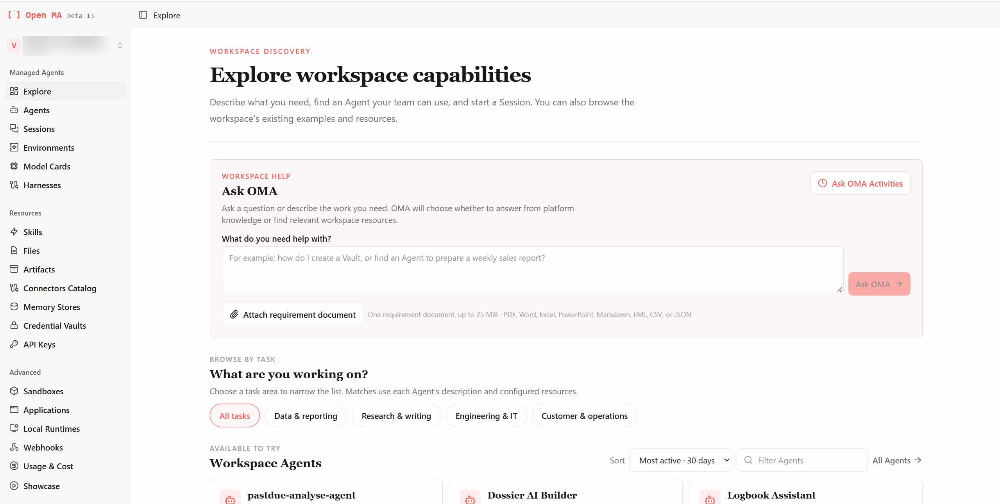
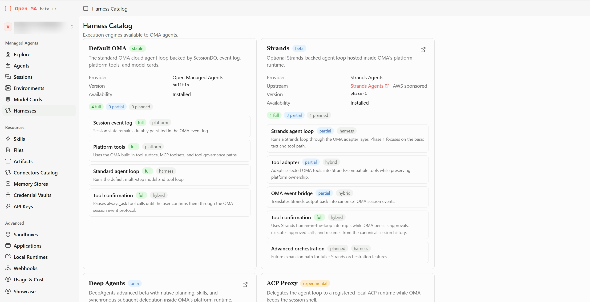
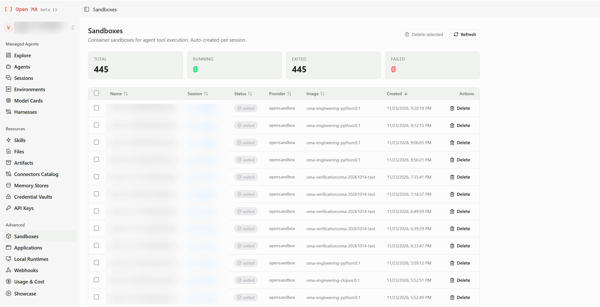
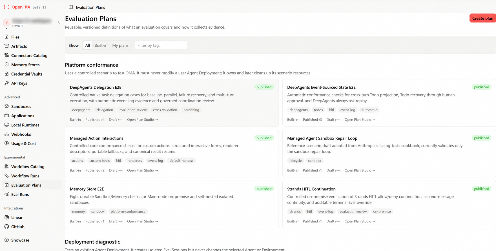
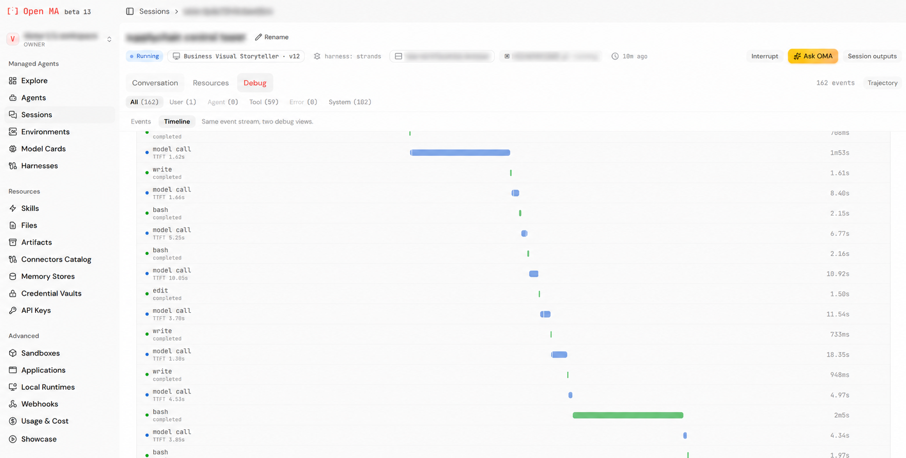
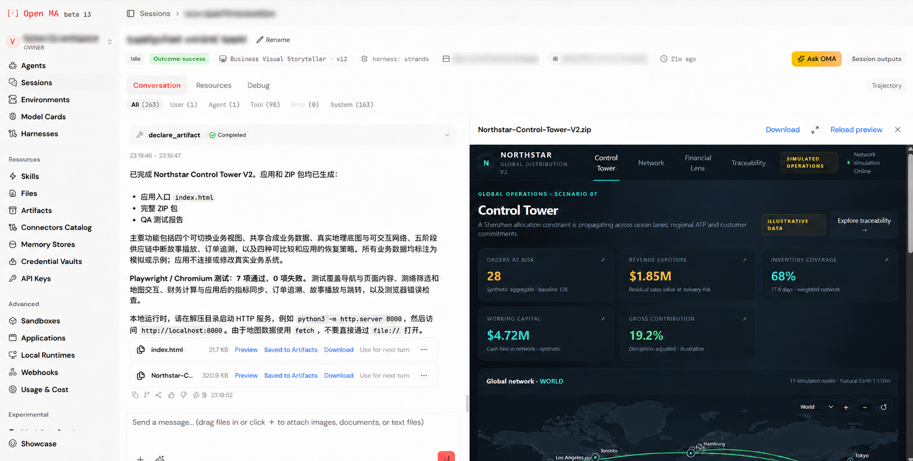

# Open Managed Agents · On-Premise

**Self-hosted Managed Agents for infrastructure you operate.** OMA provides a managed runtime, durable Sessions, governance, isolated execution, and an operator Console for teams building AI agents on-premise.

> This is the public product, documentation, showcase, and release-distribution repository. It does **not** contain the OMA application source code. Versioned installation bundles and container images are published through [GitHub Releases](https://github.com/bladexxx/On-Premise-ManagedAgents/releases) and GHCR when available.

[Open the project site](https://bladexxx.github.io/On-Premise-ManagedAgents/) · [User guide](docs/user-guide.html) · [Installation](docs/installation.html) · [SDK reference](docs/sdk-reference.html) · [Showcases](showcases/index.html) · [Releases](https://github.com/bladexxx/On-Premise-ManagedAgents/releases)

## What OMA provides

- **Agent management:** versioned Agent configurations, Model Cards, Skills, tools, MCP servers, and multiple Harnesses.
- **Durable Sessions:** persistent event history, streaming, interruption, recovery, artifacts, and execution debugging.
- **On-premise operation:** a Node-based control plane, SQLite or PostgreSQL storage, and configurable isolated sandbox workers.
- **Governance:** Workspace roles, API keys, Vaults, approval controls, and auditable activity.
- **Extensibility:** default OMA Harness, Strands, DeepAgents, custom tools, integrations, Memory Stores, Webhooks, Applications, and evaluation workflows.

Provider and Harness support varies by release. Check the versioned release notes and installation bundle before planning a deployment.

## Screenshots

Screenshots are taken from demonstration workspaces. Personal workspace names and generated session identifiers are blurred. Session artifact data is synthetic and illustrative.

| Explore and Ask OMA | Harness Catalog | Sandbox inventory |
|---|---|---|
|  |  |  |

| Evaluation Plans | Session execution timeline | Synthetic Session artifact |
|---|---|---|
|  |  |  |

## Install OMA

Start at the [installation guide](docs/installation.html). Release bundles are designed to include deployment configuration, version-pinned image references, and the standalone sandbox-worker package. The GitHub Releases page is the source of truth for available versions and checksums.

Container images are intended to be pulled from GHCR after the corresponding packages are published and marked public. See each release for the exact image tags and deployment steps.

## Documentation and demos

- [User guide](docs/user-guide.html)
- [Installation and upgrade guide](docs/installation.html)
- [TypeScript SDK reference](docs/sdk-reference.html)
- [Product screenshots](#screenshots)
- [Interactive mechanism showcases](showcases/index.html)
- [Architecture overview video](assets/videos/oma-architecture-overview.mp4)

## Release model

Keep public version tags attached to documentation-only commits in this repository. Do not publish private-source tags here: a tag exposes the target commit tree. See the [release model](docs/release-model.md) for artifact and GHCR publishing guidance.

## GitHub Pages

The root `index.html` is the Pages landing page. To publish it, open **Settings → Pages**, choose **Deploy from a branch**, select `main` and `/ (root)`, then save. The Pages site is static and does not need a build step.

## Licensing

The OMA software distribution is licensed under Apache-2.0. See [LICENSE](LICENSE) and [NOTICE](NOTICE) for terms and attribution. Each release should include the applicable license and third-party notices with its binary artifacts.
